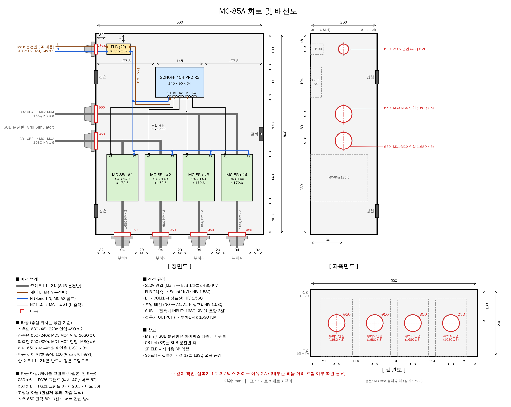
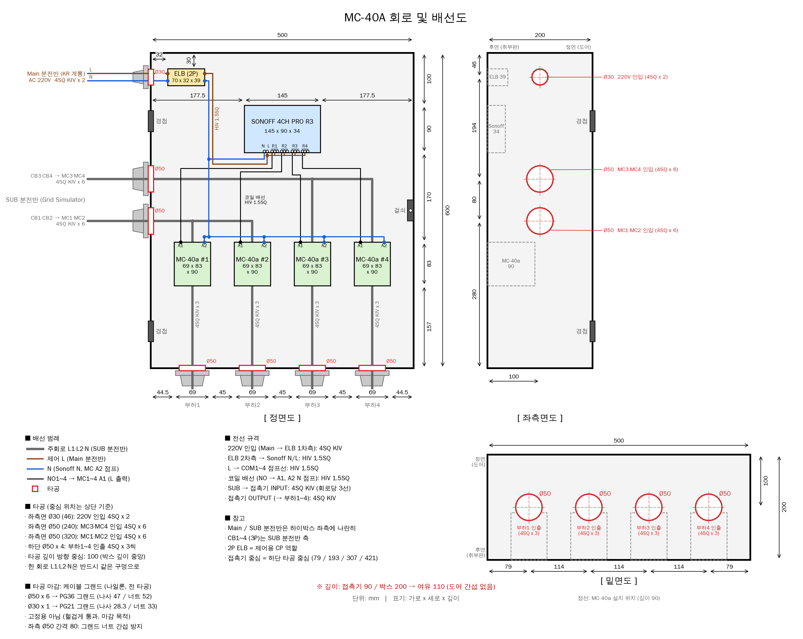

# 하이박스 접촉기 제어반 (MC-85A / MC-40A)

500 x 600 x 200 하이박스에 LS 전자접촉기 4개, Sonoff 4CH Pro R3, 2P ELB를 배치한 회로 및 배선도와 물품표.

## 폴더 구성

| 경로 | 내용 |
|---|---|
| `drawings/` | 업체 전달용 도면 (정면도 + 측면도 + 밑면도) |
| `bom/` | 물품표 (박스별 CSV/PNG, 통합 CSV) |
| `scripts/` | 도면·물품표 생성 Python 스크립트 |
| `docs/대화요약.md` | 설계 과정 및 결정 사항 요약 |

CSV는 UTF-8(BOM) 저장이라 엑셀에서 바로 열면 한글이 깨지지 않음.

## 도면

### MC-85A 회로 및 배선도


### MC-40A 회로 및 배선도


## 물품표

- `bom/물품표_MC-85A.csv`, `bom/물품표_MC-40A.csv`: 박스 1개 기준
- `bom/물품표_통합.csv`: 두 박스 합산, `적용` 열에 MC-85 / MC-40 / 공통 표시

## 다시 그리기

```bash
pip install matplotlib
# 한글 폰트: WenQuanYi Zen Hei (sudo apt install fonts-wqy-zenhei)
python3 scripts/draw_mc85.py
python3 scripts/draw_mc40.py
python3 scripts/bom_mc85.py
python3 scripts/bom_mc40.py
```

## 업체 확인 필요 사항

- MC-85A 깊이 여유 27.7 mm (도어 간섭 여부)
- 타공 깊이 방향 중심 100 mm (가정값)
- 실제 경첩/걸쇠 방향 (도면은 경첩 좌 / 걸쇠 우)
- MC-40A는 주회로 4SQ KIV 허용전류(약 30A대)가 접촉기 정격 40A보다 낮으므로 부하전류 확인
